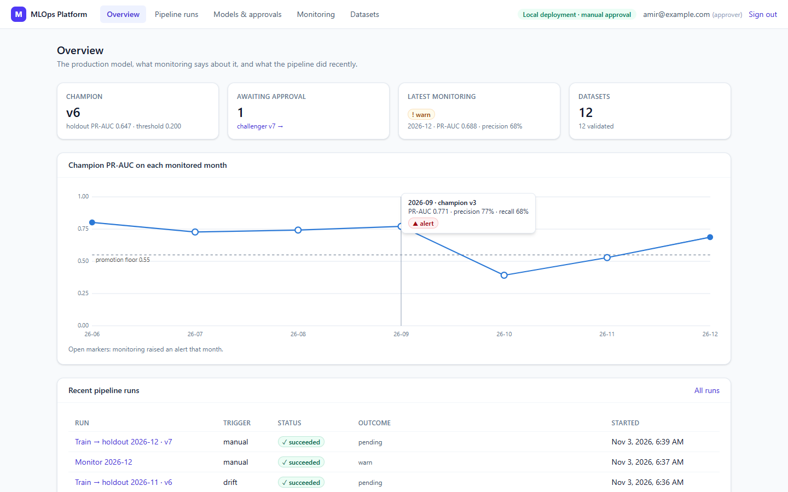
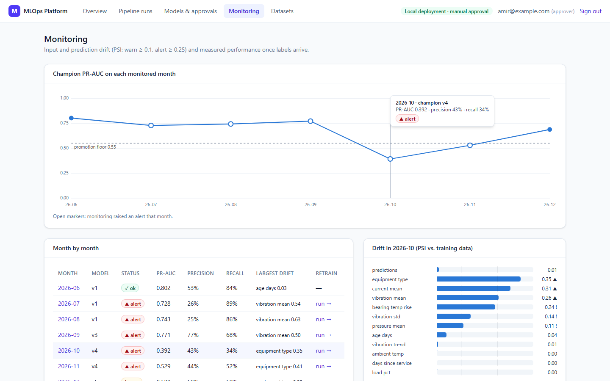
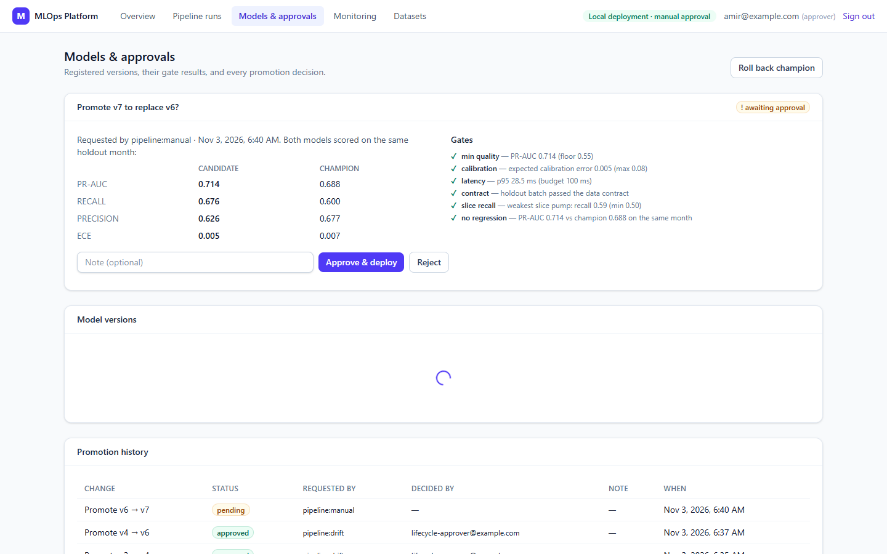
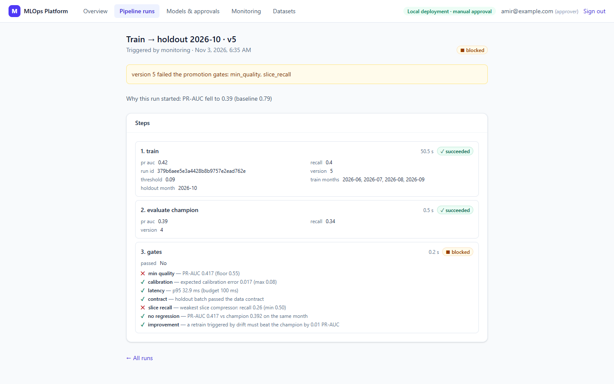
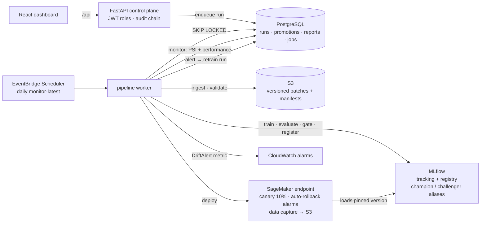

# AWS MLOps Platform

An MLOps platform that keeps a production model healthy **after** it ships. Every month of new data is
validated against a contract and versioned. Training runs are tracked in MLflow. A candidate model
replaces the production model only if it **passes promotion gates** against the champion **on the same
fresh data**, and an approver signs off. Monitoring watches input drift, prediction drift and measured
performance; when the model degrades, it **starts a retraining run by itself**. Deployments go out as
**SageMaker canaries that roll back automatically** when error or latency alarms fire.

The model predicts **machine failure within 7 days** from daily equipment telemetry (pumps, compressors,
motors). A replayed year of data includes sensor drift, a fleet change and a brand-new failure mode. On
that year the platform-managed model scores **PR-AUC 0.641 versus 0.579** for the same model left
unmanaged. It detects each change **in the month it starts**, with **0 false alarms on 12 independent
stable months**.

**Stack:** Python 3.13 · FastAPI · PostgreSQL 17 (metadata, job queue, audit chain) · MLflow 3 (tracking,
registry, aliases) · scikit-learn + XGBoost (isotonic calibration) · S3 / SeaweedFS · SageMaker real-time
endpoints · React 18 + TypeScript · Docker · Terraform (ECS, RDS, S3 + KMS, SageMaker endpoint and managed
MLflow, EventBridge Scheduler; not applied) · GitHub Actions

## The problem

Most ML projects end at "the model works on the test set". In production the data keeps changing. A
sensor is recalibrated, the fleet mix shifts, or a failure mode appears that the training data never
contained. The model gets quietly worse, and teams usually find out from the business, not from their
own tooling. The usual fixes create their own failures:
- **Retraining on a schedule** ships new models without checking that they are better.
- **Drift dashboards** raise alarms nobody can act on, or so many alarms that people stop looking.
- **Manual deployments** have no record of who promoted what, or why, and no fast way back.

## What the platform does

- **Data contracts and versioned datasets.** Each monthly batch is checked before anything uses it:
  physical ranges, null rates, duplicate keys, known categories, label rate and minimum size. Batches
  that pass are stored in S3 with a manifest and SHA-256. Every model records the hashes of the data it
  saw, so any result can be traced back to its exact inputs.
- **Tracked, reproducible training.** XGBoost with isotonic calibration, trained on a rolling four-month
  window. The alert threshold is chosen on a later validation month (precision ≥ 50%), so maintenance
  crews aren't flooded. Parameters, metrics, data hashes, the evaluation report and the drift reference
  are all logged to MLflow, and the model is registered.
- **Promotion gates.** The candidate and the current champion are both scored on the same holdout
  month. The candidate must pass every gate: a PR-AUC floor, no regression against the champion, a
  calibration limit, recall on **every** equipment type (an average can't hide a fleet the model has
  stopped protecting), a p95 latency budget and a clean data contract. A retrain started by monitoring
  must also **beat** the champion, so a retrain that learned nothing is not deployed just because it ran.
- **Approval with an audit trail.** Candidates that pass wait for an approver (or deploy themselves under
  the `auto` policy). Every promotion, rejection and rollback is recorded in a hash-chained audit log, and
  rollback is one click.
- **Monitoring that triggers action.** PSI on every feature and on the predictions. Measured PR-AUC
  against the champion's own baseline, with a tolerance sized to month-to-month noise. Precision at the
  operating threshold, to catch alert fatigue. An alert starts a retraining run on the newest data.
- **SageMaker-ready serving.** One container serves `/ping` and `/invocations` (JSON or CSV), the SageMaker
  contract. It also has a typed `/v1/predict` and Prometheus `/metrics`. On AWS a promotion creates a new
  endpoint config with data capture and rolls it out as a 10% canary with a 10-minute bake. SageMaker rolls
  back automatically if the 5xx or latency alarm fires.
- **Roles.** Viewers see everything. Engineers ingest, train and monitor. Approvers promote, reject and roll
  back. Admins manage users and see the job queue and audit chain.

**Who it is for:** ML and platform teams who run models that must stay right over time, such as predictive
maintenance, fraud, demand or risk. It is also a reference for the parts of MLOps that come *after*
training.

> **Synthetic data.** All telemetry is generated by [backend/app/ml/generator.py](backend/app/ml/generator.py):
> 240 machines, about 7,000 machine-days a month, with physics-inspired degradation, maintenance
> confounders, sensor noise and transient spikes. Every batch is reproducible from its seed. No real
> equipment or company data is involved.

## Screenshots

| Overview: the champion, pending approval, PR-AUC by month | Monitoring: drift per feature, recall per equipment type |
|---|---|
|  |  |
| **Approval: candidate vs. champion on the same month, every gate** | **A retrain blocked by the gates, with the reason** |
|  |  |

## Architecture



Locally the same code runs with SeaweedFS in place of S3, a self-hosted MLflow server, and a local model
server that follows the champion alias. Only configuration changes. The full design, including
alternatives considered, is in [docs/DESIGN.md](docs/DESIGN.md).

## Results: a year of change, replayed through the real pipeline

`python scripts/lifecycle_offline.py --gate` ingests the year and trains a first model on February–May. It
then monitors each month from June on. Every alert's retraining run goes through the gates, and the
candidates that pass are approved. The same months are also scored by a **static** copy of the first
model that is never retrained. CI runs this on every push and fails if any check below fails.

| Month | Change in the data | Champion | Monitoring | Champion PR-AUC | Static PR-AUC | What happened |
|---|---|---|---|---|---|---|
| Jun | none | v1 | ok | 0.804 | 0.804 | — |
| Jul | pump vibration sensors recalibrated | v1 | **alert** (vibration PSI 0.54) | 0.724 | 0.724 | retrain v2 **blocked**: no better than the champion |
| Aug | (continues) | v1 | **alert** | 0.742 | 0.742 | v3 passes every gate → promoted |
| Sep | + fleet shifts to compressors | v3 | **alert** | 0.772 | 0.704 | v4 → promoted |
| Oct | + new failure mode (seal leaks) | v4 | **alert** (PR-AUC 0.39) | 0.387 | 0.325 | v5 **blocked**: below the quality floor, weak on one fleet |
| Nov | (continues) | v4 | **alert** | 0.527 | 0.490 | v6 → promoted |
| Dec | (continues) | v6 | warn | 0.693 | 0.489 | — |

| Check | Result | Gate |
|---|---|---|
| Months from the start of each change to the first alert | **0** for all three | ≤ 1 |
| False alarms on independent stable months (12 extra seeds) | **0 of 12** | ≤ 1 |
| Mean PR-AUC during drift: managed vs. static | **0.641 vs. 0.579** | managed ≥ static + 0.03 |
| Candidates blocked by the gates | 2 of 5 | — |

Two findings shaped the design:
- **The new failure mode is concept drift, and input drift couldn't tell it apart.** Feature PSI had been
  alerting since July on the sensor and fleet changes. In October it looked like more of the same, and
  the prediction PSI stayed below the alert level. The signal that something new had happened was
  measured performance: PR-AUC fell from 0.77 to 0.39, and that started the retrain. Monitoring without
  labels would have missed it.
- **A tolerance of 0.02 on monthly PR-AUC raised alarms on 6 of 12 stable months.** About 200 failures a
  month gives PR-AUC a natural spread of about ±0.03. Promotion compares two models on the same month, so
  that noise cancels and 0.02 is right there. Production monitoring compares across months, so it uses
  0.08 (about 2.5 standard deviations).

The full month-by-month report is in [eval/reports/lifecycle.md](eval/reports/lifecycle.md). The limits
are in [docs/known-limitations.md](docs/known-limitations.md).

## Quick start

```bash
cp .env.example .env              # set the CHANGE_ME values
```
```bash
docker compose up -d --build
```
```bash
docker compose run --rm api python -m app.cli demo   # demo users + the year of data (~6 minutes)
```

Open http://localhost:8088. Sign in as `erin@example.com` (engineer), `amir@example.com` (approver),
`vera@example.com` (viewer) or `admin@example.com`, using the `MLP_DEMO_PASSWORD` from `.env`. MLflow is
at http://localhost:5000. The model server is at http://localhost:8080:

```bash
curl -s localhost:8080/invocations -H 'content-type: application/json' -d '{"instances": [{"unit_id": "P-001",
  "equipment_type": "pump", "age_days": 900, "days_since_service": 200, "load_pct": 85, "ambient_temp": 24,
  "vibration_mean": 4.1, "vibration_std": 0.9, "vibration_trend": 0.3, "bearing_temp_rise": 18,
  "current_mean": 42, "pressure_mean": 5.2}]}'
```

## Documentation

| | |
|---|---|
| [docs/DESIGN.md](docs/DESIGN.md) | Architecture, pipeline, gates, monitoring rules, data model, decisions and trade-offs |
| [docs/MODEL_CARD.md](docs/MODEL_CARD.md) | The failure model: data, features, metrics, intended use, limits |
| [docs/DEVELOPMENT.md](docs/DEVELOPMENT.md) | Local setup without Docker, tests, the lifecycle evaluation, project layout |
| [docs/OPERATIONS.md](docs/OPERATIONS.md) | Configuration, runbooks (drift alert, blocked candidate, bad deploy), backups |
| [docs/AWS_DEPLOYMENT.md](docs/AWS_DEPLOYMENT.md) | The AWS design, cost estimate, deploy and teardown (not deployed) |
| [docs/known-limitations.md](docs/known-limitations.md) | What it doesn't do yet |
| API reference | `/api/docs` (OpenAPI) on a running instance |
